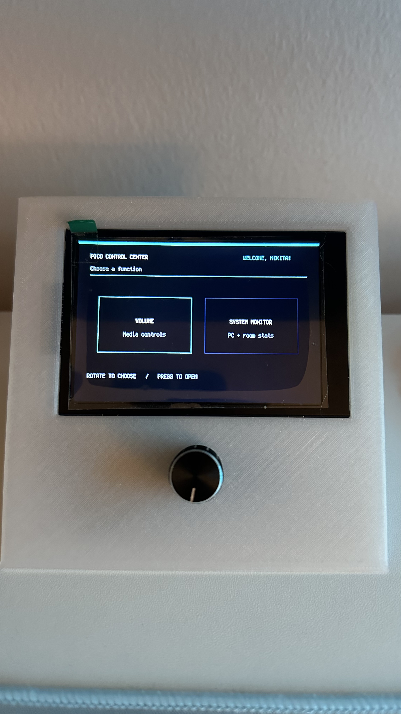
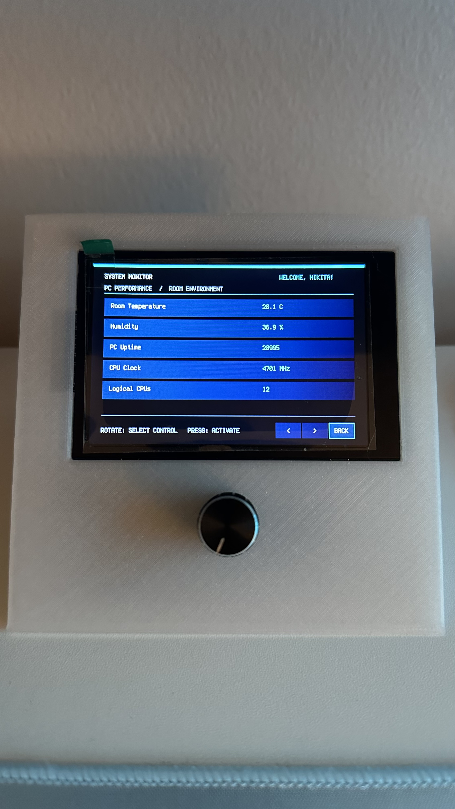
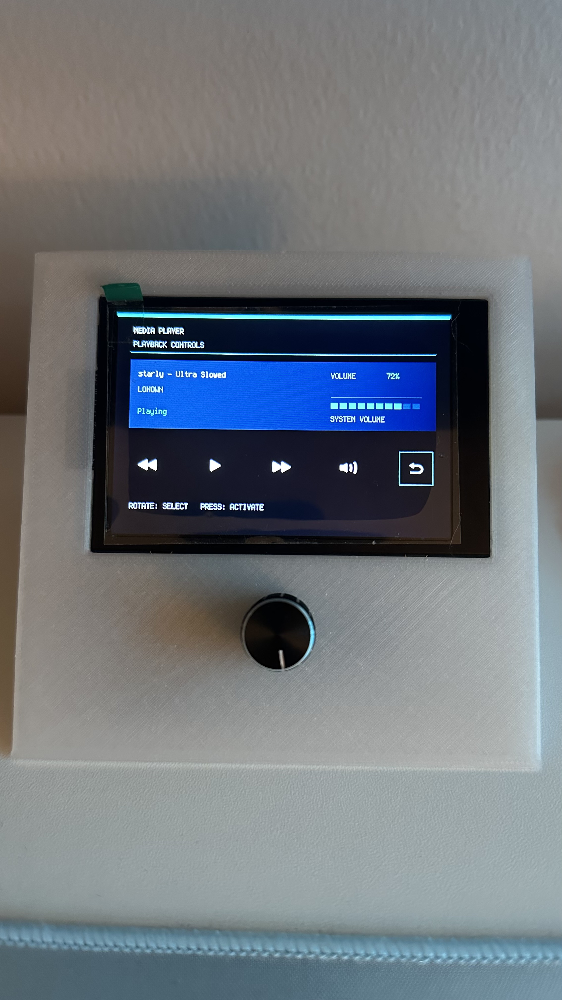

# Pico Microcontroller PC Dashboard

A Raspberry Pi Pico-based desktop dashboard with a Windows companion application, live system monitoring, environmental sensing, and media controls.



---



---



---

**Version 1.0.0** · CircuitPython · Python · Windows

The project combines a 480 × 320 ST7796 TFT display, rotary encoder, AHT10/AHT20 room sensor, USB HID media controls, and a Windows application that sends system telemetry and media-player information over USB serial.

---

## Table of Contents

- [Features](#features)
- [Architecture](#architecture)
- [Hardware and wiring](#hardware-and-wiring)
- [Pico files and libraries](#pico-files-and-libraries)
- [PC software setup](#pc-software-setup)
- [Serial configuration](#serial-configuration)
- [Communication protocol](#communication-protocol)
- [User interaction](#user-interaction)
- [Troubleshooting](#troubleshooting)
- [Known limitations](#known-limitations)
- [Version status](#version-status)

---

## Quick Start

### 1. Prepare the Raspberry Pi Pico

1. Install a compatible version of CircuitPython on the Pico.
2. Copy `code.py` and the required library files to the Pico's `CIRCUITPY` drive.
3. Copy the `images/` directory containing the five player-control bitmaps.
4. Include `boot.py` if your project uses it to configure USB CDC.

See [Pico files and libraries](#pico-files-and-libraries) for details.

### 2. Install PC dependencies

Install Python on Windows, open a terminal in the project directory, and run:

```bash
python -m pip install -r requirements.txt
```

### 3. Configure the serial port

Connect the Pico and identify its USB CDC data COM port in Windows. Update the `PORT` setting in the PC script if necessary.

### 4. Start the dashboard

Run the companion application:

```bash
python pc_dashboard.py
```

Use the rotary encoder to navigate the dashboard and select System Monitor or Volume.

---

## Features

### System Monitor

The System Monitor presents 12 metrics across three pages, with five rows per page (the last page contains the remaining metrics):

| Metric | Source | Notes |
|---|---|---|
| CPU usage | Windows PC | Percentage reported by `psutil` |
| Memory usage | Windows PC | Percentage of physical memory used |
| Disk usage | Windows PC | Percentage for the disk partition selected by the PC script |
| Network upload | Windows PC | Approximate throughput in KB/s |
| Network download | Windows PC | Approximate throughput in KB/s |
| Room temperature | AHT10/AHT20 sensor | Displayed in °C |
| Room humidity | AHT10/AHT20 sensor | Relative humidity in % |
| PC uptime | Windows PC | Seconds since Windows booted |
| CPU clock | Windows PC | Current frequency in MHz, when available |
| Logical CPUs | Windows PC | Number of logical processors |
| Running processes | Windows PC | Number of process IDs reported by `psutil` |
| Battery | Windows PC | Battery percentage, or `--` when unavailable (common on desktop PCs) |

### Media Player / Volume Menu

- Track title, artist, and playback state from Windows media sessions exposed through the Windows media API.
- Windows master-volume percentage through `pycaw`, when available.
- Local estimated-volume display as a fallback when the PC cannot provide a valid volume reading.
- Previous track, play/pause, next track, volume adjustment, and back controls.
- The five existing bitmap icons are loaded from the Pico's `/images/` directory.
- Russian song and artist names are transliterated to Latin characters on the PC before transmission. This avoids loading a large Cyrillic font onto the Pico, where RAM is limited. English text passes through unchanged.
- Player information is sampled once per second, but a player packet is sent only when the title, artist, playback state, or volume changes.

### Interface and controls

- Main menu with **Volume** and **System Monitor** choices.
- Rotary encoder for selection and navigation.
- Encoder button to activate controls.
- ST7796 TFT interface with a dark panel layout and Tiffany-colored highlights.
- Display labels are only changed when their contents differ, reducing unnecessary display-buffer allocations.

---

## Architecture

### Raspberry Pi Pico (CircuitPython)

The Pico is responsible for:

- Rendering the main menu, System Monitor, and Media Player screens.
- Reading the AHT10/AHT20 temperature and humidity sensor over I²C.
- Reading the rotary encoder and button.
- Sending mode commands to the PC over USB CDC serial.
- Receiving and parsing system-statistics packets in System Monitor mode.
- Receiving player packets in Volume mode using a separate buffer and parser.
- Sending multimedia and volume commands to Windows using USB HID Consumer Control.
- Maintaining a local volume estimate if a real Windows volume reading is not available.

### Windows PC (Python)

The PC script is responsible for:

- Gathering system statistics using `psutil`.
- Reading Windows master volume through `pycaw` and `comtypes`.
- Reading title, artist, and playback status through Windows Global System Media Transport Controls (GSMTC) sessions exposed by the `winrt` packages.
- Translating Russian Cyrillic metadata into Latin text so it can be displayed with CircuitPython's built-in font.
- Sending system-monitor data only while System Monitor mode is active.
- Sending player data only while Volume mode is active, and only when a player value changes.
- Reconnecting to the Pico if the serial connection is lost.

### Separation between the two data protocols

Both protocols use the same USB CDC serial connection, but have different mode commands, packet formats, buffers, and parsing logic. The System Monitor protocol remains independent of the player protocol.

---

## Hardware and wiring

The pin assignments below match the current Pico code.

| Component | Pico pin | Purpose |
|---|---|---|
| Rotary encoder CLK | GP12 | Encoder clock input |
| Rotary encoder DT | GP11 | Encoder direction input |
| Rotary encoder button | GP10 | Menu selection / activation |
| TFT SPI SCK | GP18 | SPI clock |
| TFT SPI MOSI | GP19 | SPI data from Pico to display |
| TFT CS | GP17 | Display chip select |
| TFT DC | GP16 | Display data/command |
| TFT RST | GP20 | Display reset |
| TFT backlight | GP21 | Backlight control |
| I²C SDA | GP1 | AHT sensor data |
| I²C SCL | GP4 | AHT sensor clock |

**Display:** ST7796 controller, 480 × 320 pixels, rotation 0 in the current code.

**Sensor:** AHT10/AHT20-compatible sensor accessed with `adafruit_ahtx0.AHTx0`.

**Media controls:** Windows receives HID Consumer Control events from the Pico. These controls do not rely on the PC's metadata API.

### Pico files and libraries

The Pico's `CIRCUITPY` drive should contain the main `code.py`, the five existing bitmap icons, and the required CircuitPython libraries. The player icons are expected at:

```text
/images/prev.bmp
/images/play.bmp
/images/next.bmp
/images/volume.bmp
/images/back.bmp
```

The code uses these CircuitPython libraries/drivers:

- `adafruit_ahtx0`
- `adafruit_imageload`
- `adafruit_display_text`
- `adafruit_display_shapes`
- `adafruit_hid`
- `circuitpython_st7796s`
- CircuitPython display, I²C, SPI, USB CDC, and USB HID modules

Install library folders from a compatible CircuitPython library bundle into `CIRCUITPY/lib` as needed. The custom `adafruit_bitmap_font` experiment was removed because loading the font caused memory-allocation failures; the current approach transliterates Russian text on the PC instead.

---

## PC software setup

The companion script runs on Windows using a local Python interpreter. Use the **same Python interpreter** to install dependencies and run the script. Thonny's Local Python and `py` in Command Prompt can point to different installations.

### Required packages

For system monitoring and serial communication:

```bash
python -m pip install psutil pyserial
```

For the Windows volume and media-player features:

```bash
python -m pip install pycaw comtypes winrt-runtime winrt-Windows.Foundation winrt-Windows.Foundation.Collections winrt-Windows.Media.Control
```

Run these commands using the Python interpreter that will execute the PC script. If using a specific interpreter, invoke that executable directly, for example:

```bat
"C:\Path\To\Python\python.exe" -m pip install psutil pyserial pycaw comtypes winrt-runtime winrt-Windows.Foundation winrt-Windows.Foundation.Collections winrt-Windows.Media.Control
```

`asyncio` is part of Python's standard library and does not need to be installed separately.

### Serial configuration

The current PC script uses:

- Port: `COM4`
- Baud rate: `115200`
- System statistics interval: approximately one second
- Player-state polling interval: approximately one second

Change `PORT = "COM4"` in the PC script if Windows assigns another COM port to the Pico's USB CDC data interface. The interface opened by the script must be the Pico's **USB CDC data** port, not an unrelated serial device.

If USB CDC data is not exposed, check the CircuitPython USB CDC configuration in `boot.py`. Do not open the same COM port in multiple PC applications simultaneously.

---

## Communication protocol

The Pico sends mode commands and the PC replies with data packets. The PC keeps the two transfer modes mutually exclusive.

### Mode commands from Pico to PC

| Command | Meaning |
|---|---|
| `START` | Enter System Monitor data-transfer mode |
| `STOP` | Stop System Monitor data transfer |
| `PLAYER_START` | Enter player data-transfer mode |
| `PLAYER_STOP` | Stop player data transfer |

The Pico periodically repeats the command for its active data mode so a PC script launched after the menu is already open can synchronize. The PC treats repeated commands as idempotent: repeated `PLAYER_START` commands do not continually reset the player-state cache.

### System Monitor packets: PC to Pico

System packets use semicolon-separated `KEY=VALUE` fields and end with a newline (`\n`). Example:

```text
CPU=4.1;RAM=34.6;DISK=94.7;UPLOAD=0.1;DOWNLOAD=0.1;UPTIME=31680;FREQ=4701;THREADS=12;PROCESSES=218;BATTERY=--\n
```

The `UPTIME` value is seconds since boot. `BATTERY=--` means a battery reading is unavailable. Additional metric fields are stored by the Pico's existing key/value parser.

System packets are sent only while the PC is in System Monitor mode. The Pico's original System Monitor serial reader and packet structure are retained in V1.

### Player packets: PC to Pico

Player packets begin with `PLAYER|` and contain pipe-separated fields. Example:

```text
PLAYER|VOLUME=72|TITLE=Gotovim Padzhero na Kray Sveta. Tolya v dele!|ARTIST=Komanda AP|PLAYBACK=Paused\n
```

The player receiver uses its own buffer, stores the most recent fields in a separate dictionary, and decodes a complete line as UTF-8 before parsing it. Waiting until a complete line is available prevents a multibyte Russian character from being split across separate decoding operations. The PC transliterates Cyrillic metadata before creating the packet, so the Pico's built-in font can display it.

The player sender checks the state approximately once per second but transmits only on the initial synchronization or when one of these values changes:

- `VOLUME`
- `TITLE`
- `ARTIST`
- `PLAYBACK`

System-statistics and player packets are not intended to be sent simultaneously. Entering one mode disables the other sender.

---

## User interaction

### Main menu

Rotate the encoder to choose Volume or System Monitor. Press the encoder button to enter the highlighted mode.

### System Monitor

- Five statistics are shown per page.
- Use the on-screen previous (`<`) and next (`>`) controls to move between pages.
- Select `BACK` to return to the main menu.
- Room temperature and humidity are read locally from the AHT sensor.

### Volume / Media Player

- Rotate to select previous track, play/pause, next track, volume adjustment, or back.
- Press the encoder button to activate the selected control.
- When the volume icon is selected, rotating the encoder sends Windows volume-increment or volume-decrement HID commands.
- The numeric volume display uses the Windows value when one is available; otherwise it uses a local estimate.
- The title and artist are displayed using Latin transliteration when the Windows metadata contains Russian Cyrillic characters.

---

## Troubleshooting

### The PC script connects, but data does not appear

1. Confirm the script uses the Pico's correct USB CDC data COM port.
2. Make sure the PC script is running before or after opening the menu; repeated mode announcements allow synchronization.
3. Confirm only one application is opening the COM port.
4. Check the PC console for `Started system monitor transfer`, `Started player data transfer`, `SENT:`, or `PLAYER SENT:` messages.

### The Volume menu displays no title or artist

- Confirm the media application exposes a Windows media session. Chrome, for example, appeared as a session during testing.
- Run the media test under the same Python interpreter that runs the PC dashboard.
- If the Windows media API cannot provide data, the script sends the unavailable-status text rather than crashing.

### Actual Windows volume is unavailable

- Confirm `pycaw` and `comtypes` are installed in the PC script's Python environment.
- The local encoder-based estimate remains available if the PC cannot return a volume value.

### CircuitPython `MemoryError`

The Pico has limited RAM, and earlier development experiments with additional font data caused memory-allocation failures. V1 avoids loading an additional Cyrillic font, uses the built-in font plus PC-side transliteration, and updates display labels only when their contents change. If modifying the UI, avoid unnecessary display objects and large fonts/bitmaps; test after each small change.

### Russian text

The Pico's built-in font does not cover all Cyrillic characters. The PC script transliterates Russian title/artist text to Latin characters before sending it. This is intentional in V1 and avoids the memory cost of loading a custom Cyrillic font.

---

## Known Limitations

- **Windows-specific PC application:** The companion script relies on Windows APIs for media sessions and master-volume control.
- **COM port configuration:** Windows may assign a different COM port when the Pico is connected. Update the `PORT` setting accordingly.
- **Media metadata availability:** Track titles, artist names, and playback states depend on whether Windows exposes the player's media session.
- **Battery readings:** Battery information may be unavailable on desktop PCs or devices that do not expose a battery reading.
- **Russian text:** Russian track and artist metadata is transliterated into Latin characters on the PC because the Pico uses its built-in font rather than loading a larger Cyrillic font.

---
  
## Version status

**V1.0 — stable baseline for continued development.**

The current version includes the three-mode UI (main menu, System Monitor, Volume/Media Player), 12 system/room metrics, the independent player-data protocol, change-driven player updates, Windows master-volume and media-session integration, startup mode reannouncement, and PC-side Russian transliteration. Preserve this version as a known-good baseline before experimenting with additional fonts, display objects, or protocol changes.
